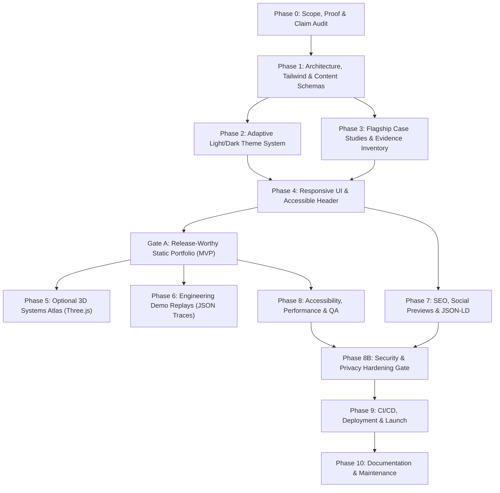

# Master Implementation Plan: Agentic AI Systems Atlas v2.2
**Document Source Analysis:** `D:\Abhishek Website\newupdate 29 10\AGENTIC_AI_SYSTEMS_ATLAS_V2_2_SECURE_IMPLEMENTATION_PLAN.md`  
**Target Codebase:** `D:\Abhishek Website\v2-astro` (and root deployment)  
**Engineering Lead:** Abhishek Raut  
**Status:** Architecture Blueprint, Phased Plan & Actionable To-Do List  

---

## 1. Executive Summary & Document Understanding

The file `AGENTIC_AI_SYSTEMS_ATLAS_V2_2_SECURE_IMPLEMENTATION_PLAN.md` in `newupdate 29 10` establishes a production-grade, security-hardened, evidence-first architectural roadmap for your personal portfolio website.

### Key Tenets & Strategic Shifts Identified:
1. **Target Positioning:** AI Engineer | Agentic AI Systems | Forward-Deployed AI Engineering | Applied R&D.
2. **Two-Theme Palette:** Strict **Light** and **Dark** themes (replacing the experimental `hacker/cyberpunk` palette from initial iterations) with:
   - **System Default:** Automatically aligns with the visitor's OS/browser preference (`prefers-color-scheme`).
   - **One-Click Quick Toggle:** A single visible Sun/Moon icon button in desktop/mobile headers toggles between Light ↔ Dark and locks an explicit preference.
   - **Device Theme Reset ("Auto"):** Accessible button/control to clear local override and return to dynamic OS tracking.
   - **Zero-FOUC & CSP-Safe Bootstrap:** Self-hosted `/assets/theme-init.js` or SHA-256 hashed inline script preventing any white/black flash of unstyled content.
3. **Evidence-First Content & Flagship Projects:**
   - 6 Flagship Projects with structured evidence, task-DAGs, provenance, and verifiable outcomes:
     - **Paradox AI:** Contract-governed agent runtime with task-DAG and checkpoint verification.
     - **Sanjaya.ai:** Privacy-first desktop/browser agent with DOM redaction boundaries.
     - **CodeAgent:** Offline-first security scanning, SARIF/CWE normalization, and policy gates.
     - **Engineering Knowledge RAG:** Hybrid sparse/dense retrieval, reranking, and evidence verification.
     - **VehicleGPT:** Edge telemetry ingestion and offline compute under device constraints.
     - **Private Memory OS:** Human-in-the-loop verified decision/task memory with temporal links.
4. **Security & Privacy Hardening (Phase 8B Release Gate):**
   - Public repository and production builds treated as distinct trust boundaries.
   - Zero live unauthenticated agent backends or API keys exposed to browser clients.
   - Synthetic/sanitized replay traces only for interactive demonstrations.
   - Strict Content Security Policy (CSP), subresource integrity, and dependency pinning.
5. **Progressive Enhancement & Performance:**
   - Static-first Astro architecture: all core content, case studies, and navigation must be 100% accessible with JavaScript and WebGL disabled.
   - Optional 3D Systems Atlas: Three.js graph loaded lazily with clean resource disposal (`geometry.dispose()`, `material.dispose()`) and automatic 2D fallback.

---

## 2. Gap Analysis: Current Codebase (`v2-astro`) vs. Atlas v2.2 Plan

| Capability | Current State in `v2-astro` | Atlas v2.2 Requirement | Gap / Remediation Needed |
| :--- | :--- | :--- | :--- |
| **Theme System** | Uses `'light' \| 'hacker'` with a circular view transition | Exactly two palettes: `'light'` and `'dark'`; `tokens.css` with CSS variables for Light & Dark; system-aware preference with one-click quick switch + Auto reset | Align tokens to exact Light/Dark palettes; rewrite `theme.ts` & header toggle controls to adhere to the CSP-safe contract |
| **Styling Framework** | Pure CSS (`tokens.css` + `motion.css`) | Astro + Tailwind CSS + semantic CSS variables | Add `@astrojs/tailwind` or Tailwind v4 for utility-first responsive layout while retaining CSS custom properties |
| **Content Architecture** | `src/data/projects.json` (partial list of 5 projects) | Astro Content Collections (`src/content/projects/*.mdx`), strict Zod schemas, 6 flagship case studies | Implement `src/content.config.ts`, define schemas with metrics, constraints, tradeoffs, and author 6 case studies |
| **Security Gate (8B)** | Basic `.nojekyll` and static HTML generation | Phase 8B Security checklist: CSP target, secret scans, lockfile pinning, safe link policies (`rel="noopener noreferrer"`) | Add security headers/meta, audit dependencies, create threat model document, sanitize all assets |
| **3D Visualization** | Canvas particle animation in `reveals.js` | Optional interactive 3D Systems Atlas with Three.js (lazy-loaded, 2D fallback, reduced-motion aware) | Scaffold `SystemsAtlas.astro` with Three.js dynamic import and resilient 2D SVG/HTML graph fallback |
| **Demo Replays** | None | Recorded, offline JSON traces for Paradox, Sanjaya, CodeAgent, RAG | Build read-only replay components without live tool access |

---

## 3. Architecture Dependency Graph

---

## 4. Phased Master Implementation Plan

### Phase 0: Scope, Proof, and Confidentiality
- **Objective:** Freeze positioning, audit all numbers and claims, and ensure NDA/IP compliance.
- **Key Deliverables:**
  - `docs/product-brief.md`: Defining 3 primary audiences (technical recruiters, industry collaborators, researchers).
  - `docs/content-inventory.csv`: Verifying all claims, links, and project maturity tags (Concept, Research, Prototype, Validated, Deployed).
  - `docs/risk-register.md`: Mitigations for claim validation, mobile WebGL fallback, and privacy.

### Phase 1: Repository, Architecture, and Data Model
- **Objective:** Establish the static Astro foundation with strict TypeScript, Tailwind CSS, and typed Content Collections.
- **Key Deliverables:**
  - Configure Tailwind CSS with semantic CSS custom properties in `v2-astro`.
  - Implement `src/content.config.ts` using Astro's modern content layer with strict Zod schemas.
  - Establish standardized route structure: `/`, `/projects`, `/projects/[slug]`, `/research`, `/experience`, `/about`, `/contact`, `/404`.

### Phase 2: Adaptive Light/Dark Appearance (Top-Priority UX)
- **Objective:** Exactly two full visual palettes (`light` and `dark`) with zero wrong-theme flash and strict CSP compliance.
- **Key Deliverables:**
  - Complete token sets in `tokens.css`: background, surface, text, muted, borders, accents, charts.
  - Zero-FOUC theme bootstrap (`theme-init.js`) loaded synchronously in `<head>` before stylesheets.
  - Accessible Header controls: visible Sun/Moon one-click toggle + secondary "Auto" device reset button.
  - Fallback CSS with `@media (prefers-color-scheme: dark)` ensuring proper rendering without JavaScript.

### Phase 3: Profile Content & Evidence-Based Case Studies
- **Objective:** Author factual, compelling case studies that communicate high engineering rigor.
- **Key Deliverables:**
  - 6 Flagship Case Studies authored in MDX:
    1. **Paradox AI:** Task-DAG, deterministic execution gates, checkpoint recovery.
    2. **Sanjaya.ai:** Bounded browser agent, DOM redaction boundaries, PII scrubbing.
    3. **CodeAgent:** Offline security audit pipeline, SARIF normalization, AST-driven patches.
    4. **Engineering Knowledge RAG:** Hybrid retrieval (BM25 + Dense vector), re-ranking, and provenance validation.
    5. **VehicleGPT:** Embedded telemetry ingestion, edge inference budgets, CAN-bus simulation.
    6. **Private Memory OS:** Human-confirmed memory store, temporal linking, privacy preservation.
  - Factual Experience Timeline, verifiable Education, and genuine Publications/Citations.

### Phase 4: Core Information Architecture & Responsive UI
- **Objective:** Build an accessible, clean UI functioning seamlessly from 320px mobile to 1920px desktop.
- **Key Deliverables:**
  - Responsive header featuring immediate Sun/Moon toggle and navigation drawer.
  - Hero section with verified positioning and dual CTAs ("Explore Systems", "View CV").
  - Flagship project cards with maturity tags, stack pills, and direct case study links.
  - Accessible landmarks, skip links, focus rings, and WCAG 2.2 AA compliant contrast.

### Phase 5: Optional Interactive 3D Systems Atlas
- **Objective:** Distinctive Three.js architecture constellation with robust 2D fallback.
- **Key Deliverables:**
  - `SystemsAtlas.astro`: Dynamic Three.js island that lazy-loads only when in viewport.
  - 2D accessible fallback (HTML/SVG graph) rendering immediately for no-JS, reduced motion, or WebGL-disabled clients.
  - Resource lifecycle management: complete cleanup of geometries, textures, and animation frames on route change.

### Phase 6: Engineering Demo Replays
- **Objective:** Interactive recorded traces showcasing runtime behavior without exposing private backends.
- **Key Deliverables:**
  - Standardized JSON replay schema (`step`, `operation`, `input`, `policy`, `output`, `status`).
  - Read-only visualizers for Paradox AI task execution and Sanjaya DOM redaction.

### Phase 7: Search, Social Preview, and Discoverability
- **Objective:** SEO and rich metadata across all static pages.
- **Key Deliverables:**
  - Automated `sitemap.xml`, `robots.txt`, and Open Graph preview cards (1200x630).
  - Validated JSON-LD structured data (`Person`, `SoftwareSourceCode`, `ScholarlyArticle`).

### Phase 8 & 8B: Accessibility, Speed, and Security Hardening Gate
- **Objective:** Strict release gate ensuring compliance with performance, accessibility, and security standards.
- **Key Deliverables:**
  - **Phase 8:** Core Web Vitals (LCP <= 2.5s, CLS <= 0.1), axe-core zero critical violations, cross-browser Playwright test matrix.
  - **Phase 8B Security:**
    - Threat model document (`docs/security/threat-model.md`).
    - CSP policy targeting self-hosted assets and hashed inline bootstrap.
    - Automated secret scanning (no keys, private student records, or internal tokens).
    - Supply chain review: frozen lockfiles (`package-lock.json`), pinned GitHub Actions SHAs.

### Phase 9: CI/CD, Deployment, and Launch
- **Objective:** Automated, reproducible build and deploy pipeline.
- **Key Deliverables:**
  - GitHub Actions workflow running linting, typechecking, content validation, and production build.
  - Deployment to GitHub Pages (or Cloudflare Pages for HTTP response headers).

### Phase 10: Documentation & Maintenance
- **Objective:** Long-term project health and ease of content updates.
- **Key Deliverables:**
  - `README.md` update instructions, content contribution guide, and decision logs.

---

## 5. Master Phased To-Do Checklist

### Phase 0: Scope, Proof & Claim Audit
- [ ] **A01 · P0 · S** Define 3 primary audiences (recruiters, collaborators, researchers) in `docs/product-brief.md`.
- [ ] **A02 · P0 · S** Freeze positioning: "AI Engineer | Agentic AI Systems | Forward-Deployed AI Engineering | Applied R&D".
- [ ] **A03 · P0 · M** Audit legacy v1 routes, links, and assets before framework migration.
- [ ] **A04 · P0 · M** Inventory projects, credentials, and achievements in `docs/content-inventory.csv`.
- [ ] **A05 · P0 · M** Tag all projects with maturity badges: Concept / Research / Prototype / Validated / Deployed.
- [ ] **A06 · P0 · M** Complete IP, NDA, and confidentiality review (sanitize internal institutional data).
- [ ] **A07 · P0 · M** Verify all numerical metrics (e.g. 500+ students, 5+ projects) with defensible sources.
- [ ] **A08 · P0 · S** Freeze MVP exclusions: no active server databases, no live LLM API keys in client.

### Phase 1: Repository & Data Architecture
- [x] **B01 · P0 · S** Ensure clean git state on branch `main` and branch `v2`.
- [x] **B02 · P0 · M** Verify strict TypeScript configuration in `v2-astro/tsconfig.json`.
- [x] **B03 · P0 · S** Configure Tailwind CSS and link semantic CSS custom variables.
- [x] **B04 · P0 · M** Create `src/content.config.ts` with Zod schemas for projects, experience, and publications.
- [x] **B05 · P0 · M** Enable MDX support for rich case studies via `@astrojs/mdx`.
- [x] **B06 · P0 · M** Establish static routes: `/`, `/projects`, `/projects/[slug]`, `/experience`, `/about`, `/contact`, `/404`.
- [x] **B07 · P0 · S** Validate canonical base URLs for GitHub Pages (`/`) and custom domains.
- [x] **B08 · P0 · M** Implement modular layouts: `BaseLayout.astro`, `PageHead.astro`, `Header.astro`, `Footer.astro`.

### Phase 2: Adaptive Light/Dark Theme System (P0 Critical)
- [x] **C01 · P0 · M** Finalize dual token palettes (Light vs. Dark) in `tokens.css` ensuring >= 4.5:1 text contrast.
- [x] **C02 · P0 · S** Bind variables to `:root`, `[data-theme='light']`, and `[data-theme='dark']`.
- [x] **C03 · P0 · S** Default to `System` preference via `matchMedia('(prefers-color-scheme: dark)')`.
- [x] **C04 · P0 · S** Implement zero-FOUC synchronous theme bootstrap script in `PageHead.astro` / `BaseLayout.astro`.
- [x] **C05 · P0 · M** Build `ThemeSwitch.astro` / `Header.astro` with visible one-click Sun/Moon button + secondary "Auto" device reset.
- [x] **C06 · P0 · S** Persist manual preference in `localStorage.setItem('atlas-theme-preference')`; remove key on Auto.
- [x] **C07 · P0 · S** Bind `matchMedia` listener to dynamically update UI when OS changes (only in Auto mode).
- [x] **C08 · P1 · S** Sync theme changes across browser tabs via `window.addEventListener('storage')`.
- [x] **C09 · P0 · S** Gracefully handle private browsing / disabled `localStorage` without breaking toggle.
- [x] **C10 · P0 · S** Sync `color-scheme` property on `<html>` to style scrollbars and native inputs properly.
- [x] **C13 · P0 · S** Add no-JS CSS fallback rule using `@media (prefers-color-scheme: dark)`.

### Phase 3: Flagship Case Studies & Profile Content
- [x] **D01 · P0 · S** Polish Hero section: professional headline, verified contact links, and dual CTAs.
- [x] **D02 · P0 · M** Author factual About section highlighting applied R&D and agentic systems.
- [x] **D03 · P0 · M** Implement case study template (`src/pages/projects/[id].astro`).
- [x] **D04 · P0 · L** Author **Paradox AI** case study (Contract-governed agent runtime, task-DAGs, validation).
- [x] **D05 · P0 · L** Author **Sanjaya.ai** case study (Privacy-first desktop agent, DOM redaction, PII safety).
- [x] **D06 · P0 · L** Author **CodeAgent** case study (Offline vulnerability scanning, SARIF/CWE normalization).
- [x] **D07 · P0 · L** Author **Engineering Knowledge RAG** case study (Hybrid retrieval, reranking, source validation).
- [x] **D08 · P0 · L** Author **VehicleGPT** case study (Edge computing, CAN telemetry ingestion, device budget).
- [x] **D09 · P0 · L** Author **Private Memory OS** case study (Human-confirmed memory, temporal provenance).
- [x] **D12 · P0 · S** Publish verified experience timeline and reachable PDF resume link (`/Abhishek Raut Resume 0226.pdf`).
- [x] **D14 · P0 · S** Verify official contact channels: `abhishek.raut@pccoepune.org`, LinkedIn, and GitHub.

### Phase 4: Core Responsive UI & Navigation
- [ ] **E01 · P0 · M** Implement responsive grid and typography scale supporting 320px to 1920px viewports.
- [ ] **E02 · P0 · M** Finalize accessible Header with responsive navigation drawer and theme controls.
- [ ] **E03 · P0 · M** Implement 6 Flagship Cards with maturity pills, stack badges, and hover reveals.
- [ ] **E04 · P1 · M** Add client-side domain filters (Agentic AI, Edge AI, Security, Healthcare) with static fallback.
- [ ] **E08 · P0 · S** Construct clean Footer with sitemap links, copyright, and verified external profiles.
- [ ] **E10 · P0 · S** Add accessibility skip link (`#main-content`), focus rings, and proper ARIA landmarks.

### Phase 5: Optional 3D Systems Atlas
- [ ] **F01 · P1 · M** Define architecture graph schema: nodes, links, technology clusters in `src/lib/graph-data.ts`.
- [ ] **F02 · P1 · M** Scaffold lightweight Three.js canvas component with deterministic node positioning.
- [ ] **F05 · P0 · M** Build resilient 2D SVG/HTML graph fallback for non-WebGL/no-JS environments.
- [ ] **F07 · P1 · M** Lazy-load Three.js using `IntersectionObserver` or "Explore 3D" trigger.
- [ ] **F09 · P0 · S** Enforce `prefers-reduced-motion` to stop orbital rotation automatically.
- [ ] **F12 · P1 · M** Implement explicit WebGL memory disposal (`geometry.dispose()`, `material.dispose()`).

### Phase 6: Engineering Demo Replays
- [ ] **G01 · P1 · M** Define typed replay JSON schema for agent execution steps.
- [ ] **G02 · P1 · M** Construct Paradox AI task-DAG execution replay component.
- [ ] **G03 · P1 · M** Construct Sanjaya.ai DOM redaction step-by-step visualizer.
- [ ] **G08 · P1 · S** Clearly tag all replay traces as "Synthetic/Sanitized Demonstration Data".

### Phase 7: SEO & Discoverability
- [ ] **H01 · P0 · S** Add dynamic, unique page titles and meta descriptions across all routes.
- [ ] **H02 · P0 · S** Configure canonical links and Open Graph meta tags.
- [ ] **H04 · P1 · S** Add validated `Person` JSON-LD schema with verified affiliations.
- [ ] **H06 · P0 · S** Generate `sitemap.xml` and `robots.txt` in static output.

### Phase 8 & 8B: Security Hardening & Release Gate
- [ ] **S01 · P0 · M** Publish Threat Model in `docs/security/threat-model.md`.
- [ ] **S04 · P0 · M** Perform automated Git secret scan ensuring no API keys or private tokens exist.
- [ ] **S07 · P0 · M** Enforce strict HTML sanitization; eliminate raw `set:html` or `eval()`.
- [ ] **S10 · P0 · S** Audit all outbound links to ensure `rel="noopener noreferrer"`.
- [ ] **S11 · P0 · M** Self-host all fonts and icons; eliminate third-party tracker scripts.
- [ ] **S16 · P0 · L** Define and test strict Content Security Policy (CSP).
- [ ] **S20 · P0 · S** Restrict `localStorage` usage strictly to `atlas-theme-preference`.
- [ ] **S23 · P0 · S** Ensure reproducible builds via `npm ci` and committed lockfile.
- [ ] **S27 · P0 · S** Pin all GitHub Actions in `.github/workflows/` to full commit SHAs.

### Phase 9: CI/CD & Production Launch
- [ ] **J01 · P0 · M** Configure GitHub Actions workflow running linting, build, and tests.
- [ ] **J03 · P0 · M** Configure GitHub Pages static deployment with `.nojekyll`.
- [ ] **J08 · P0 · S** Execute final pre-launch smoke test (both themes, mobile navigation, all links).
- [ ] **J09 · P0 · S** Verify live deployment in clean incognito browser window.

---

## 6. Recommended Immediate Next Steps (Sprint 1)
1. **Initialize Dependencies:** Add Tailwind CSS and `@astrojs/mdx` to `v2-astro`.
2. **Execute Phase 2 (Themes):** Replace current hacker theme with the exact, CSP-safe Light/Dark theme controller and header Sun/Moon toggle.
3. **Establish Content Collections:** Configure `content.config.ts` and author the 6 flagship case studies.
4. **Deploy Static MVP:** Fulfill Gate A (Content-safe static portfolio).
