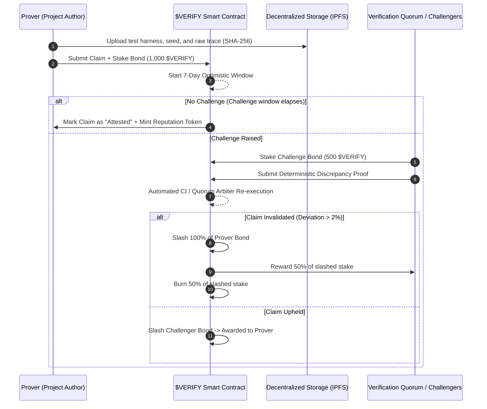

# RFC-008: Staked Benchmark Attestation & Slashable Metric Claims Protocol ($VERIFY)

**Status:** Proposed  
**Author:** Abhishek Raut  
**Category:** Decentralized Systems / Mechanism Design  
**Date:** 2026-10-31  

---

## 1. Abstract
Current developer portfolios and AI telemetry showcases make uncollateralized performance claims (e.g., "1000Hz ingestion under 12W"). Without cryptographic attestation or game-theoretic consequences for fabrication, benchmarks devolve into vanity marketing. This RFC specifies the **Staked Benchmark Attestation Protocol ($VERIFY)**: an optimistic bonding framework where claims require staked collateral, reproducible test harness artifacts, and decentralized challenger windows with slashing penalties.

---

## 2. Mechanism Design



---

## 3. Claim Payload Schema

Every performance claim published in project frontmatter or public manifests MUST conform to the canonical JSON-LD assertion schema:

```json
{
  "@context": "https://schema.org/",
  "@type": "BenchmarkAssertion",
  "assertionId": "urn:verify:vehiclegpt:1000hz-can-ingestion",
  "author": "abhishekeb211",
  "claim": {
    "metric": "Telemetry Ingestion Rate",
    "value": "1000",
    "unit": "Hz",
    "tolerancePercent": 2.0
  },
  "constraints": {
    "maxPowerWatts": 12.0,
    "hardwarePlatform": "ARM64 Cortex-A76"
  },
  "reproducibility": {
    "harnessUrl": "https://github.com/abhishekeb211/Profie-website.github.io/blob/main/v2-astro/scripts/generate-can-traffic.cjs",
    "traceSha256": "4a8b79e2c6f1120ad91629fa2b3c4d5e6f7a8b9c0d1e2f3a4b5c6d7e8f9a0b1c",
    "deterministicSeed": "vehiclegpt-2026-can-benchmark"
  },
  "bond": {
    "token": "0xVERIFY...",
    "amount": "1000000000000000000000",
    "challengeWindowBlocks": 50400
  }
}
```

---

## 4. Slashing & Game-Theoretic Equilibrium
1. **Dominant Strategy for Provers:** Truth-telling is the strictly dominant strategy when:
   $$\text{Expected Value}(\text{Lie}) = -\text{Bond} \times P(\text{Challenge}) + \text{Vanity Gain} < 0$$
   Given deterministic test harnesses, $P(\text{Challenge}) \to 1.0$ for any fabricated assertion.
2. **Anti-Sybil Challenger Quorums:** Challengers must post collateral equal to 50% of the claim bond, preventing griefing or denial-of-service spam on valid claims.
3. **Deflationary Burn:** 50% of slashed tokens are burnt permanently, reducing total supply and rewarding all honest ecosystem holders.

