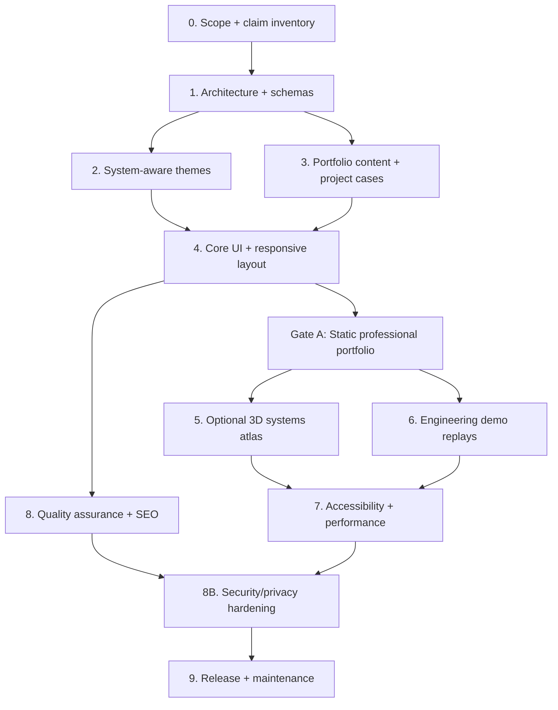

# Agentic AI Systems Atlas v2.2
## Master Implementation Roadmap and Engineering Checklist

**Owner:** Abhishek Raut  
**Positioning:** AI Engineer | Agentic AI Systems | Forward-Deployed AI Engineering | Applied R&D  
**Product:** Premium, evidence-first, progressively enhanced personal portfolio  
**Architecture choice:** Astro (static) + TypeScript + Tailwind CSS + content collections/MDX + Three.js (lazy) + limited GSAP  
**Themes:** Exactly two rendered palettes (Light/Dark); a prominent one-click sun/moon toggle; System follows the visitor’s OS/browser until an explicit override; an unobtrusive **Use device theme** reset is available  
**Hosting:** Cloudflare Pages preferred when enforceable security response headers are required; GitHub Pages remains a valid static-only option with documented limitations  
**Status:** Security-hardened implementation plan. The planned Astro/3D website is not claimed to be built; a separate lightweight starter update may implement the theme behavior.


> **Scope and counts:** 155 individually checkable tasks across 11 original phases plus a new security hardening gate (Phase 8B): **P0 105**, **P1 46**, **P2 4**. The immediate priority is P0 work; 3D and nonessential demos remain optional.

### Priorities and estimation
- **P0** = essential before launch; **P1** = desired showcase feature; **P2** = optional enhancement.
- **S** = small, roughly up to 1 hour; **M** = medium, roughly a working day; **L** = multi-day research/implementation. All are planning heuristics, not delivery promises.
- Each task lists **Done** (objective acceptance evidence) and **Needs** (IDs or prior phase).
- A task is complete only when its code/content, a test or review result, and evidence of acceptance are committed.
- Do not fabricate benchmarks, citations, production deployments, employer endorsements or proprietary client details.

## Dependency chain



## Phase 0 — Scope, proof, and confidentiality
**Goal:** Freeze who the site serves, which projects can be shown, and which claims are verifiable.

- [ ] **A01 · P0 · S** Define 3 primary audiences: technical recruiters, industry collaborators, researchers. **Done:** `docs/product-brief.md` states one goal and CTA for each. **Needs:** —
- [ ] **A02 · P0 · S** Freeze one-sentence professional positioning and hero copy. **Done:** approved headline, subheadline, 2 CTAs and a 100-word biography. **Needs:** A01
- [ ] **A03 · P0 · M** Audit all current v1 pages, links and assets before changing frameworks. **Done:** inventory, preserved route list and before screenshots. **Needs:** A01
- [ ] **A04 · P0 · M** Inventory projects, roles, papers, education, awards and credentials. **Done:** `content-inventory.csv` with link, ownership and verification state per item. **Needs:** A02
- [ ] **A05 · P0 · M** Classify each project: Concept / Research / Prototype / Validated / Deployed. **Done:** each project tagged with stage, evidence and latest verification date. **Needs:** A04
- [ ] **A06 · P0 · M** Conduct intellectual-property, NDA and privacy review. **Done:** public/sanitized/private classification; no nonpublic data in assets or commits. **Needs:** A04
- [ ] **A07 · P0 · M** Audit every number and achievement claim. **Done:** evidence URL, source file or explicit 'unverified/omit' outcome for each claim. **Needs:** A04
- [ ] **A08 · P0 · S** Freeze MVP scope and feature exclusions. **Done:** no accounts, AI chat backend, live agent tool access or required 3D in MVP. **Needs:** A01
- [ ] **A09 · P1 · M** Define representative demo data policy. **Done:** documented synthetic/sanitized event traces and clear labels. **Needs:** A06
- [ ] **A10 · P1 · S** Create a risk register. **Done:** risks for claims, 3D, mobile accessibility, search, broken links and privacy each have mitigations. **Needs:** A03–A09

## Phase 1 — Repository, architecture, and data model
**Goal:** Deliver a static-first Astro foundation without losing tested v1 behavior.

- [ ] **B01 · P0 · S** Freeze v1 as a tagged baseline and create `v2/astro` branch. **Done:** baseline build and smoke tests preserved. **Needs:** A03
- [ ] **B02 · P0 · M** Initialize Astro with static output and strict TypeScript. **Done:** `npm run dev` and `npm run build` pass. **Needs:** B01
- [ ] **B03 · P0 · S** Configure Tailwind CSS and semantic CSS variables. **Done:** global stylesheet and tokens compile. **Needs:** B02
- [ ] **B04 · P0 · M** Define typed schemas for project, publication, experience, skill, highlight, writing. **Done:** invalid frontmatter or JSON fails validation. **Needs:** B02,A04
- [ ] **B05 · P0 · M** Introduce Astro content collections, with MDX only where rich narrative is required. **Done:** 2 sample real or explicitly demo case pages built. **Needs:** B04
- [ ] **B06 · P0 · M** Configure routes: `/`, `/projects`, `/projects/[slug]`, `/research`, `/experience`, `/about`, `/contact`, `/404`. **Done:** static output for all enabled pages. **Needs:** B05
- [ ] **B07 · P0 · S** Support account-site, project-path and custom-domain base URLs. **Done:** links work with `/` and a nonroot base path. **Needs:** B02
- [ ] **B08 · P0 · M** Create shared `BaseLayout`, `PageHead`, `Header`, `Footer`, `Section`, `Card`. **Done:** no duplicate navigation or metadata boilerplate. **Needs:** B03,B06
- [ ] **B09 · P1 · M** Isolate browser-only features into lazy client modules. **Done:** static pages contain essential content without JavaScript; 3D is not in the initial page bundle. **Needs:** B02,B08
- [ ] **B10 · P0 · S** Add ESLint, Prettier, TypeScript checks and npm scripts. **Done:** `lint`, `typecheck`, `build`, `test` commands run from clean checkout. **Needs:** B02

## Phase 2 — Adaptive Light/Dark appearance (highest-priority UX requirement)
**Goal:** Exactly two full visual themes; **one visible Light ↔ Dark switch** in the header; first visit follows browser/OS appearance, a click pins a manual override, and a small **Use device theme** reset restores automatic matching. This is a two-theme experience, not three competing visual themes.

- [ ] **C01 · P0 · M** Define two complete token palettes: background, surface, text, muted, borders, accent, focus, error, success, chart and graph. **Done:** tokens document + contrast review. **Needs:** B03
- [ ] **C02 · P0 · S** Implement CSS variables under `:root`, `[data-theme=light]` and `[data-theme=dark]`. **Done:** all components use tokens, no scattered hard-coded UI colors. **Needs:** C01
- [ ] **C03 · P0 · S** Make `System` the default preference, not Light. **Done:** first visit follows `matchMedia('(prefers-color-scheme: dark)')`. **Needs:** C02
- [ ] **C04 · P0 · S** Apply resolved theme using a tiny **self-hosted, parser-blocking theme bootstrap before CSS** (preferred for strict CSP), or an exact-hash-approved inline script. **Done:** no wrong-theme flash on cold navigation or reload. **Needs:** C03
- [ ] **C05 · P0 · M** Add a **single visible sun/moon Light ↔ Dark toggle** in both desktop/mobile headers, plus a secondary accessible **Use device theme** reset (for example, inside the appearance menu). **Done:** one click changes palette immediately, keyboard/assistive tech labels announce the next action, the active preference is conveyed accessibly, and **Use device theme** restores automatic browser matching. **Needs:** C03
- [ ] **C06 · P0 · S** Persist an explicit Light/Dark choice made by the quick-toggle in `localStorage`; remove key when System is selected. **Done:** quick-toggle overrides survive refresh while System remains dynamic; no account or cookie required. **Needs:** C05
- [ ] **C07 · P0 · S** Listen for device preference changes while System is selected. **Done:** live OS switch updates theme; explicit overrides stay pinned. **Needs:** C03,C06
- [ ] **C08 · P1 · S** Sync override changes across tabs using the `storage` event. **Done:** two tabs settle on same explicit preference. **Needs:** C06
- [ ] **C09 · P0 · S** Handle storage-disabled/private browsing without errors. **Done:** UI still changes for current page; System remains fallback. **Needs:** C06
- [ ] **C10 · P0 · S** Keep `color-scheme`, form controls, scrollbar, selection and syntax-highlight colors in sync. **Done:** no light controls inside dark page. **Needs:** C02,C04
- [ ] **C11 · P0 · M** Theme every UI component: header, nav, cards, timeline, project tags, buttons, diagrams, code, footer, modals. **Done:** Light/Dark screenshot diff review passes. **Needs:** C02,B08
- [ ] **C12 · P1 · M** Theme 3D nodes, connectors, tooltips, canvas background and labels without remounting renderer. **Done:** theme switch has no memory leak or large layout jump. **Needs:** C02,F02
- [ ] **C13 · P0 · S** Provide no-JavaScript system-theme CSS fallback. **Done:** `prefers-color-scheme` media rule paints readable default if JS unavailable. **Needs:** C02
- [ ] **C14 · P0 · M** Automate theme preference and **one-click toggle** matrix tests. **Done:** quick toggle from System/Light/Dark, persisted override, Use device theme reset, two rapid clicks, responsive header, keyboard, refresh, OS changes, cross-tab, storage denied, no-JS, and first-paint checks all pass. **Needs:** C03–C13

**Theme precedence (single source of truth):** explicit local override (`light`/`dark`) > current system/browser preference > `light` as last-resort compatibility fallback. Store the preference, not the resolved appearance. On choosing `system`, delete the key. **Quick switch rule:** one click switches the **current visible palette** (light → dark or dark → light) and saves that choice as a manual override. A System option remains available to return to live browser/OS matching. Do not silently revert a manual choice when the OS theme changes.


**Security-specific theme acceptance:** The theme preference key must accept only `light` or `dark`, never arbitrary values. Do not insert stored strings as HTML or CSS. The initial theme script must be covered by a verified CSP hash; use separate HTML/CSS assets where possible. Verify the page remains readable when CSP blocks a resource or JavaScript is disabled.

### Theme initializer implementation contract

**Theme logic reference below:** The preferred production implementation places these same instructions in a small, synchronous **self-hosted `/assets/theme-init.js` loaded before CSS**. This avoids an inline-script CSP exception. If the reference is inlined, hash its exact bytes and verify the resulting CSP in the deployed build. The full site can define event-based preference changes later.

```html
<meta name="color-scheme" content="light dark" />
<script is:inline>
  (() => {
    const KEY = 'atlas-theme-preference';
    const root = document.documentElement;
    const query = matchMedia('(prefers-color-scheme: dark)');
    let override = null;
    const valid = value => value === 'light' || value === 'dark';
    try {
      const saved = localStorage.getItem(KEY);
      if (valid(saved)) override = saved;
    } catch (_) { /* storage may be unavailable */ }

    const apply = () => {
      const resolved = override || (query.matches ? 'dark' : 'light');
      root.dataset.theme = resolved;
      root.dataset.themePreference = override || 'system';
      root.style.colorScheme = resolved;
      root.dispatchEvent(new CustomEvent('atlas:theme-applied', {
        detail: { theme: resolved, preference: override || 'system' }
      }));
    };
    apply();
    query.addEventListener?.('change', () => { if (!override) apply(); });
    addEventListener('storage', event => {
      if (event.key !== KEY) return;
      override = valid(event.newValue) ? event.newValue : null;
      apply();
    });
    addEventListener('atlas:theme-selection', event => {
      const next = event.detail;
      if (next !== 'system' && !valid(next)) return;
      override = valid(next) ? next : null;
      try {
        if (override) localStorage.setItem(KEY, override);
        else localStorage.removeItem(KEY);
      } catch (_) { /* apply in memory anyway */ }
      apply();
    });
  })();
</script>
```

The one-click switch and a secondary Use device theme reset control should dispatch `new CustomEvent('atlas:theme-selection', { detail: 'system' | 'light' | 'dark' })` on `window`. The initializer also emits `atlas:theme-applied` on `<html>` after every effective-theme change, including changes from other tabs or the operating system. Keep the bootstrap small and dependency-free. Prefer self-hosted external loading to keep `script-src 'self'`; if it is inline, use a verified hash/nonce and never silently weaken CSP.

### Mandatory header interaction: a single Light/Dark toggle with device-aware default

- **Visible default:** One accessible sun/moon button in desktop and mobile headers. It changes the effective palette with one click. No three-button segmented theme selector on the main page.
- **System-aware initial visit:** If there is no saved preference, respect the browser/OS via `prefers-color-scheme`.
- **Explicit override:** Clicking the toggle pins the opposite visible palette in `localStorage` (the only stored appearance data).
- **Return to automatic:** A small `Use device theme` action in the appearance menu clears the key. An equivalent accessible action may be placed beside the toggle.
- **Correctness:** If the system changes under manual override, do not change the site. If it changes under automatic mode, follow it. When storage fails, keep the toggle functional for the current page.
- **Accessibility:** The icon represents the *next action*, and the accessible button name says `Switch to light mode` or `Switch to dark mode`. The device-reset action is a real keyboard-reachable button.
- **Security:** Never store credentials, tokens, personal activity or project data alongside the appearance preference. Do not let query parameters or untrusted content set executable attributes.

**Reference interaction code (`ThemeSwitch.astro`):**

```astro
<div class="theme-actions" role="group" aria-label="Appearance">
  <button type="button" data-theme-toggle aria-label="Switch color theme" title="Switch Light/Dark">☾</button>
  <button type="button" data-theme-auto aria-label="Use device appearance" title="Follow device appearance">Auto</button>
</div>
<script>
  const root = document.documentElement;
  const toggle = document.querySelector<HTMLButtonElement>('[data-theme-toggle]');
  const reset = document.querySelector<HTMLButtonElement>('[data-theme-auto]');
  const sync = () => {
    const next = root.dataset.theme === 'dark' ? 'light' : 'dark';
    if (toggle) {
      toggle.setAttribute('aria-label', `Switch to ${next} mode`);
      toggle.textContent = next === 'dark' ? '☾' : '☀';
    }
    if (reset) reset.setAttribute('aria-pressed', String(root.dataset.themePreference === 'system'));
  };
  toggle?.addEventListener('click', () => window.dispatchEvent(new CustomEvent(
    'atlas:theme-selection', {detail: root.dataset.theme === 'dark' ? 'light' : 'dark'}
  )));
  reset?.addEventListener('click', () => window.dispatchEvent(new CustomEvent(
    'atlas:theme-selection', {detail: 'system'}
  )));
  root.addEventListener('atlas:theme-applied', sync);
  sync();
</script>
```

Use one shared controller for multiple desktop/mobile buttons, or scope each controller; remove listeners if page transitions repeatedly mount components. The head initializer preceding the CSS must be allowed by a **script hash** in a strict CSP or replaced with an equivalent audited external bootstrap. Avoid `unsafe-inline`/`unsafe-eval` as permanent CSP exceptions.

**Acceptance:** First visit follows device appearance; one click switches Light ↔ Dark instantly and saves the manual override; Auto resumes following the device. Both palettes render with consistent chart, diagram, graph and 3D materials, even if storage access is blocked.

**Fallback CSS:**

```css
:root {
  --bg: #f7f9fc;
  --surface: #ffffff;
  --text: #14213d;
  --muted: #516078;
  --border: #dfe5ef;
}
@media (prefers-color-scheme: dark) {
  :root:not([data-theme]) {
    --bg: #0b1020;
    --surface: #17233b;
    --text: #f1f5f9;
    --muted: #abb8d0;
    --border: #30405a;
  }
}
:root[data-theme='light'] { color-scheme: light; }
:root[data-theme='dark'] {
  color-scheme: dark;
  --bg: #0b1020;
  --surface: #17233b;
  --text: #f1f5f9;
  --muted: #abb8d0;
  --border: #30405a;
}
body { background: var(--bg); color: var(--text); }
```

This is a reference contract, not a claim of implementation. Audit contrast for all actual component states before release.

## Phase 3 — Profile content and evidence-based case studies
**Goal:** Deliver a credible portfolio even if JavaScript or WebGL is blocked.

- [ ] **D01 · P0 · S** Add polished hero, professional identity and two CTAs (Explore Systems, View CV/Contact). **Done:** content is factual and readable without JS. **Needs:** A02,B08
- [ ] **D02 · P0 · M** Add About section and forward-deployed engineering focus without unsupported role claims. **Done:** biography and skills reviewed. **Needs:** A02,A07
- [ ] **D03 · P0 · M** Implement case-study schema: context, problem, constraints, role, architecture, tradeoffs, implementation, methods, metrics, evidence, stage and next steps. **Done:** schema validates and page template renders optional fields cleanly. **Needs:** B04,A05
- [ ] **D04 · P0 · L** Author flagship **Paradox AI** case study (contract-governed agent runtime). **Done:** task-DAG, capabilities, verification, checkpoints, concrete personal contributions and evidence. **Needs:** D03,A06
- [ ] **D05 · P0 · L** Author flagship **Sanjaya.ai** case study (privacy-first browser/desktop agent). **Done:** DOM-first flow, redaction boundaries, bounded-action model, limitations and evidence. **Needs:** D03,A06
- [ ] **D06 · P0 · L** Author flagship **CodeAgent** case study (offline security scanning). **Done:** SARIF/CWE normalization, policy gates, provenance, evaluation methods; metrics only with defensible sources. **Needs:** D03,A06
- [ ] **D07 · P0 · L** Author flagship **Engineering Knowledge RAG** case study. **Done:** ingestion, chunking, embeddings, hybrid retrieval, verification and controlled evaluation matrix. **Needs:** D03,A06
- [ ] **D08 · P0 · L** Author flagship **VehicleGPT** case study. **Done:** edge constraints, telemetry ingestion, query/analytics pipeline, viable device budget and simulation evidence. **Needs:** D03,A06
- [ ] **D09 · P0 · L** Author flagship **Private Memory OS** case study. **Done:** human-verified decision/task memory, provenance, temporal links and privacy boundaries. **Needs:** D03,A06
- [ ] **D10 · P1 · M** Prepare secondary project inventory: Samanvay-7, VEGAPilot, UAV HSI/LiDAR and other valid R&D. **Done:** concise overview with permission-safe descriptions and correct maturity labels. **Needs:** A05,A06
- [ ] **D11 · P1 · M** Add publication, talk, patent and award entries where source-verified. **Done:** publisher/DOI/venue/author facts checked; missing claims omitted. **Needs:** A07
- [ ] **D12 · P0 · S** Publish correct experience timeline and reachable CV. **Done:** all dates, titles and employment claims validated; CV URL returns 200. **Needs:** A07
- [ ] **D13 · P1 · S** Connect skills to actual projects rather than generic percentages. **Done:** each major claimed capability links to one or more case studies. **Needs:** D04–D09
- [ ] **D14 · P0 · S** Configure email, GitHub and professional profile links. **Done:** all outbound destinations checked and public contact details intentional. **Needs:** A02

## Phase 4 — Core information architecture and responsive UI
**Goal:** Make the static portfolio polished before 3D is introduced.

- [ ] **E01 · P0 · M** Build responsive page shell with content-width and spacing system. **Done:** 320px–1920px layouts do not horizontally overflow. **Needs:** B08,C11
- [ ] **E02 · P0 · M** Build accessible desktop/mobile header with an **immediately visible Light ↔ Dark icon/button**, and a secondary Use device theme reset action. **Done:** one-click toggle works on desktop and mobile, device reset works, no duplicate IDs, and keyboard/Escape/focus/screen reader checks pass. **Needs:** E01,C05
- [ ] **E03 · P0 · M** Build hero with professional headline, capabilities and evidence-linked CTAs. **Done:** first screen communicates identity in both themes. **Needs:** D01,E01
- [ ] **E04 · P0 · M** Build six flagship cards with truthful maturity badges and clickable details. **Done:** card, links, alt text, keyboard and reading order tested. **Needs:** D04–D09
- [ ] **E05 · P1 · M** Add client-side project filters (domain, method, status); preserve full static listing. **Done:** no required content hidden without JS. **Needs:** E04
- [ ] **E06 · P0 · M** Build evidence-first project details, method/metrics/constraints panels and architecture figures. **Done:** all primary case studies follow common structure. **Needs:** D03,E01
- [ ] **E07 · P1 · M** Build experience timeline, publication listing and skills-by-evidence layout. **Done:** entries link to verifiable material. **Needs:** D11–D13
- [ ] **E08 · P0 · S** Build clear footer, contact and ownership/legal links. **Done:** all links valid and no stale placeholder content. **Needs:** D14
- [ ] **E09 · P1 · M** Build consistent diagrams, tables, code blocks, and callouts. **Done:** all readable in Light/Dark and on mobile. **Needs:** C11,E06
- [ ] **E10 · P0 · S** Implement skip link, headings, breadcrumbs, keyboard focus ring and accessible landmarks. **Done:** keyboard-only navigation smoke test passes. **Needs:** E01

## Phase 5 — Optional interactive 3D systems atlas
**Goal:** Distinctive, useful architecture visualization with 2D fallback.

- [ ] **F01 · P1 · M** Define graph schema: domains, projects, shared technologies, evidence-backed relationships. **Done:** nodes/edges have unique IDs, labels, types and accessible destination URLs. **Needs:** D04–D09
- [ ] **F02 · P1 · M** Prototype a simple deterministic Three.js graph. **Done:** no network request or live AI required to render; scene loads on desktop. **Needs:** F01,B09
- [ ] **F03 · P1 · M** Design semantic nodes for Agentic AI, Trust/Security, RAG/Memory, Edge AI and Applied R&D. **Done:** clicking a node filters/navigates to relevant work. **Needs:** F01
- [ ] **F04 · P1 · M** Add accessible hit targets, hover/focus descriptions and clear navigation. **Done:** mouse/touch interactions do not trap focus. **Needs:** F02
- [ ] **F05 · P0 · M** Provide equivalent 2D project map/list independent of WebGL. **Done:** all graph destinations available with keyboard and no JS. **Needs:** F01
- [ ] **F06 · P1 · S** Connect light/dark design tokens to 3D material colors and labels. **Done:** change happens in place without recreating WebGL renderer. **Needs:** C12,F02
- [ ] **F07 · P1 · M** Lazy-load renderer only when graph enters the viewport or visitor chooses Explore 3D. **Done:** no 3D dependency on initial content paint. **Needs:** F02
- [ ] **F08 · P1 · M** Add adaptive quality (device pixel ratio cap, node budget, optional motion). **Done:** mobile retains usable interaction without frame-rate collapse. **Needs:** F07
- [ ] **F09 · P0 · S** Respect `prefers-reduced-motion` and offer Pause motion. **Done:** no continuous orbital animation for reduced-motion users. **Needs:** F02
- [ ] **F10 · P1 · S** Pause rendering off-screen, on hidden tab and while idle. **Done:** frame loop stops when appropriate. **Needs:** F07
- [ ] **F11 · P0 · M** Handle WebGL unavailable/context lost gracefully. **Done:** 2D map remains visible and functional. **Needs:** F05,F02
- [ ] **F12 · P1 · M** Dispose geometries, materials, textures, controls and animation listeners on removal. **Done:** repeat navigation shows no growing GPU memory trend. **Needs:** F02
- [ ] **F13 · P1 · M** Measure LCP effect, bundle transfer, frame times and GPU usage; set release budget after baseline. **Done:** benchmark report and documented feature kill-switch. **Needs:** F07–F12

## Phase 6 — Interactive engineering demonstrations (recorded, not live tools)
**Goal:** Let visitors inspect how engineering systems behave without exposing private systems.

- [ ] **G01 · P1 · M** Define common replay format: step, input, operation, policy, output, evidence, status. **Done:** typed, versioned demo JSON and disclosure text. **Needs:** A09,D03
- [ ] **G02 · P1 · M** Build Paradox AI task-DAG / policy / execution / verification replay. **Done:** each event selectable, with failure and checkpoint examples. **Needs:** G01
- [ ] **G03 · P1 · M** Build Sanjaya.ai privacy-conscious browser-agent action replay. **Done:** DOM step, PII redaction example, approval and bounded execution shown. **Needs:** G01
- [ ] **G04 · P1 · M** Build CodeAgent pipeline explorer. **Done:** sample scan → SARIF normalization → dedup → policy → report trace. **Needs:** G01
- [ ] **G05 · P1 · M** Build RAG retrieval/evidence explorer. **Done:** documents → chunks → sparse/dense retrieval → rerank → evidence verification. **Needs:** G01
- [ ] **G06 · P2 · M** Build VehicleGPT offline telemetry reasoning replay. **Done:** sample trip query shows measurements, calculations and answer provenance. **Needs:** G01
- [ ] **G07 · P2 · M** Build Private Memory OS temporal provenance walkthrough. **Done:** extraction candidates → user confirmation → persisted memory → retrieval. **Needs:** G01
- [ ] **G08 · P1 · S** Clearly mark synthetic/illustrative event data and real project maturity (mandatory whenever a replay is published). **Done:** demos never imply unperformed experiments or production actions. **Needs:** G02–G07
- [ ] **G09 · P1 · M** Provide static screenshots/transcripts for demos, with download-safe sample data if appropriate. **Done:** browser with JS disabled still shows meaningful demonstration. **Needs:** G02–G07

## Phase 7 — Search, social preview and research discoverability
**Goal:** Every page should be self-describing and searchable without executing 3D.

- [ ] **H01 · P0 · S** Add unique titles and descriptions on homepage/project/research pages. **Done:** build check finds no duplicate/empty metadata. **Needs:** B06,D03
- [ ] **H02 · P0 · S** Generate canonical and Open Graph URLs with correct base paths. **Done:** absolute URLs are valid on GitHub Pages and custom domains. **Needs:** B07
- [ ] **H03 · P1 · M** Generate social images for profile and flagship projects. **Done:** working, readable 1200×630 assets, no stale placeholders. **Needs:** D04–D09
- [ ] **H04 · P1 · S** Add accurate `Person` JSON-LD and selected verified software/project structured data. **Done:** rich-result validation with no false credentials. **Needs:** A07,D11
- [ ] **H05 · P1 · M** Add `ScholarlyArticle` only for bibliographically verified publications. **Done:** authors, DOI, year, venue and URLs match publisher records. **Needs:** D11
- [ ] **H06 · P0 · S** Generate sitemap, robots, 404 page and sensible URL slugs. **Done:** sitemap lists every public route and no demo/private URLs. **Needs:** B06
- [ ] **H07 · P0 · M** Use semantic HTML, headings, image alt text and accessible names. **Done:** automated checks and manual reading-order audit pass. **Needs:** E01–E10
- [ ] **H08 · P1 · S** Set up Google Search Console if owner chooses. **Done:** ownership confirmed, sitemap submitted, indexing inspection recorded. **Needs:** H06,site launch

## Phase 8 — Accessibility, speed, reliability and security QA
**Goal:** Validate the user experience across devices and modes, not just the developer laptop.

- [ ] **I01 · P0 · M** Record baseline Lighthouse (mobile/desktop) before adding 3D. **Done:** reports and test profiles committed. **Needs:** E01
- [ ] **I02 · P0 · M** Optimize photos, project thumbnails, fonts and social assets. **Done:** responsive dimensions, modern formats and lazy loading where appropriate. **Needs:** E01
- [ ] **I03 · P0 · M** Establish base-page JS budget, and a separate 3D budget if enabled. **Done:** differential build report; optional visuals do not block content. **Needs:** I01; F07 if 3D enabled
- [ ] **I04 · P0 · M** Validate Core Web Vitals: LCP ≤ 2.5s, INP ≤ 200ms, CLS ≤ 0.1 at the 75th percentile when field data is available. **Done:** RUM or reproducible lab proxy clearly labelled. **Needs:** I01
- [ ] **I05 · P0 · M** Test at 320, 375, 390, 768, 1024, 1440 and 1920 CSS pixels. **Done:** no clipped text, sideways scroll, unusable nav or overlapping graph. **Needs:** E01
- [ ] **I06 · P0 · M** Test all primary flows keyboard-only, with focus indicators and screen reader spot checks. **Done:** keyboard paths documented; no blockers. **Needs:** E10,F05
- [ ] **I07 · P0 · M** Run axe-core and manual WCAG 2.2 AA audit in both themes. **Done:** no known critical/serious violations; text contrast ≥ 4.5:1 for normal text. **Needs:** C14,E10
- [ ] **I08 · P0 · M** Verify motion reduction and static fallbacks across UI; add 3D pause checks if enabled. **Done:** `prefers-reduced-motion: reduce` tests pass. **Needs:** E01; F09 if 3D enabled
- [ ] **I09 · P0 · L** Run Playwright regression on Chromium, Firefox and WebKit with mobile viewports. **Done:** screenshot diffs and E2E checks pass. **Needs:** C14,E01
- [ ] **I10 · P0 · M** Test one-click Light ↔ Dark switching, System reset, theme state combinations and first paint in fresh contexts. **Done:** no FOUC, no wrong theme after refresh, override remains pinned, OS preference change respected in System mode; both mobile and desktop controls pass. **Needs:** C14,I09
- [ ] **I11 · P0 · M** Test with JavaScript disabled, storage denied and slow-network simulation; block WebGL if 3D is enabled. **Done:** readable profile, project list and contact survive. **Needs:** E10; F11 if 3D enabled
- [ ] **I12 · P1 · M** Test 3D resource lifecycle (theme toggles, resize, navigate, hidden tabs). **Done:** no crash and no sustained resource leak. **Needs:** F12
- [ ] **I13 · P0 · S** Crawl internal/external links and publication URLs. **Done:** no known broken essential links. **Needs:** D11,D14
- [ ] **I14 · P0 · M** Run the dedicated Phase 8B security track before deploy. **Done:** S01–S35 security report and critical controls are checked; no private datasets or credentials published. **Needs:** B10
- [ ] **I15 · P0 · S** Validate privacy behavior in both themes (no trackers or calls beyond approved assets). **Done:** browser network inventory matches S11/S20 and documented third-party policy. **Needs:** I14

## Phase 8B — Security, privacy and deployment hardening (release gate)
**Goal:** Treat the public code repository, build pipeline, published artifacts, user browser and sanitized project demonstrations as distinct trust boundaries. This is a static portfolio, so eliminate unnecessary server-side attack surface rather than introducing authentication or an always-running AI agent.

### Threat model and confidential research data
- [ ] **S01 · P0 · M** Establish a threat model for repository → CI → static host → browser → downloadable assets → prerecorded demos. **Done:** `docs/security/threat-model.md` covers assets, trust boundaries, abuse cases, likelihood, impact and owner. **Needs:** A06,B02
- [ ] **S02 · P0 · M** Identify attack surfaces: Markdown/MDX, links, client scripts, third-party packages, GLB/SVG/media, CI actions, custom domain and demo traces. **Done:** inventory lists every input and execution sink. **Needs:** S01
- [ ] **S03 · P0 · M** Classify case studies, screenshots, videos and architecture graphs as public / sanitized / excluded. **Done:** reviewed asset register; no proprietary diagrams, customer data, keys or private source pasted into build. **Needs:** A06,S01
- [ ] **S04 · P0 · M** Scan repository, all retained Git history and production output for secrets or sensitive data. **Done:** automated secret scanner + manual review of files, maps, logs and archived artifacts, with zero unresolved verified leaks. **Needs:** S03
- [ ] **S05 · P0 · S** Document containment for an accidentally published credential or private artifact. **Done:** revoke/rotate source credentials, remove public build, purge caches where possible, assess exposure; history rewrite alone is not treated as erasure. **Needs:** S04
- [ ] **S06 · P0 · M** Verify personal contributions, experiment status and permitted employer/client mentions. **Done:** every portfolio claim has provenance and disclosure approval or is omitted. **Needs:** A05,A07,S03

### Content injection, browser safety and third-party assets
- [ ] **S07 · P0 · M** Encode user/content-derived output by HTML, attribute and URL context. **Done:** no unsanitized `innerHTML`, Astro `set:html`, dynamic event attributes, `eval` or `new Function`; test fixtures cover injection strings. **Needs:** B04,S02
- [ ] **S08 · P0 · M** Lock down Markdown/MDX rendering: author-approved content, reviewed component allowlist and no arbitrary embedded scripts. **Done:** malicious markdown, raw HTML, links and SVG test cases fail build or render inert. **Needs:** S07
- [ ] **S09 · P0 · S** Enforce allowed URL schemes and canonical project paths; reject `javascript:`, `data:` links, unknown URI handlers and invalid redirects. **Done:** automated schema/link validation. **Needs:** B04,S07
- [ ] **S10 · P0 · S** Enforce safe external links. **Done:** `target=_blank` links use `rel=noopener noreferrer`; inbound referrer information is minimized via policy. **Needs:** S09
- [ ] **S11 · P0 · M** Self-host fonts and approved icons; remove unnecessary third-party analytics, tag managers, remote JS and embedded frames. **Done:** network test shows only approved origins; no covert data collection. **Needs:** E01,S02
- [ ] **S12 · P1 · M** Establish a graphics/media supply-chain policy for SVG, GLB/glTF, textures, WASM and fonts. **Done:** trusted origins, size limits, MIME/extension checks and license tracking; never treat a model file as executable content. **Needs:** F02,S02
- [ ] **S13 · P0 · M** Publish replay demos from synthetic or explicitly approved sanitized fixtures only. **Done:** no emails, token strings, system prompts, customer names, internal URLs, private documents or reusable action credentials in traces. **Needs:** A09,G01,S03
- [ ] **S14 · P0 · S** Keep live tools, browser automation, code execution, LLM providers and API keys out of the public site. **Done:** demos are read-only playback; no visitor-submitted commands reach a real agent. **Needs:** A08,S13
- [ ] **S15 · P1 · M** If an interactive backend is later introduced, require a separate security design before implementation. **Done:** authentication, authorization, rate limiting, budget caps, tool sandbox, CSRF/CORS and abuse controls designed and reviewed; feature is *disabled* until approved. **Needs:** S14

### CSP, HTTPS, hosting and user privacy
- [ ] **S16 · P0 · L** Build and test a restrictive Content Security Policy: explicit self-hosted assets, approved hashes for the initial theme bootstrap, no blanket `unsafe-inline` or `unsafe-eval`. **Done:** browser CSP regression covers theme toggle, Astro scripts, JSON-LD and graph; malicious inline execution is blocked. **Needs:** C04,S07,S11
- [ ] **S17 · P0 · M** Choose host based on required response headers. **Done:** Cloudflare Pages `public/_headers` is tested for HTTP-level CSP, `frame-ancestors` and other headers, **or** GitHub Pages limitations are documented with compensating measures (CSP meta only, where supported). **Needs:** B07,S16
- [ ] **S18 · P0 · S** Enforce HTTPS, verify DNS/TLS, eliminate mixed content and assess HSTS compatibility at the chosen host. **Done:** public site and assets use HTTPS and redirect correctly; certificates valid. **Needs:** S17
- [ ] **S19 · P0 · M** Set appropriate response headers when hosting supports them: CSP, `X-Content-Type-Options: nosniff`, `Referrer-Policy`, restrictive `Permissions-Policy`, framing controls and tested caching. **Done:** production HTTP header assertions pass. **Needs:** S17
- [ ] **S20 · P0 · S** Limit browser storage to an allowlisted `light`/`dark` theme preference; System = no key. **Done:** no account IDs, API tokens, browsing history, visitor analytics or demo data in local storage; no cookies in MVP. **Needs:** C06,S02
- [ ] **S21 · P0 · S** Use a safe contact path without public secrets or unnecessary server endpoints. **Done:** `mailto:` or a separately reviewed service; no homemade unauthenticated write API. **Needs:** D14,S14
- [ ] **S22 · P1 · S** Define privacy and security contact/disclosure text suitable for a portfolio. **Done:** publish clear collection practices and responsible issue-reporting channel without exposing private information. **Needs:** S20,S21

### Supply chain, CI/CD and repository ownership
- [ ] **S23 · P0 · S** Commit lockfiles and use reproducible installs (`npm ci`); pin runtime/toolchain versions in CI. **Done:** clean dependency resolution and reproducible build on fresh runner. **Needs:** B10
- [ ] **S24 · P0 · M** Perform full dependency review, including development/build packages and install scripts. **Done:** `npm audit` plus documented triage; no unresolved critical/high *exploitable* vulnerabilities at launch. **Needs:** S23
- [ ] **S25 · P0 · M** Add automated dependency updates and alerts with human review; never auto-merge unknown major upgrades. **Done:** Dependabot or equivalent workflow and owner/cadence configured. **Needs:** S24
- [ ] **S26 · P0 · M** Apply least-privilege CI/CD: read-only default, isolated deploy job for Pages permissions, OIDC where supported. **Done:** audit documents token scopes and PRs do not gain deploy permissions. **Needs:** J01
- [ ] **S27 · P0 · S** Pin external GitHub Actions to reviewed full commit SHAs, not mutable tags; restrict allowed actions. **Done:** workflow policy/test detects unpinned actions. **Needs:** S26
- [ ] **S28 · P0 · M** Protect the default branch and deployment environment with code review and required checks. **Done:** no unreviewed changes can silently replace public content; rollback path tested. **Needs:** S26
- [ ] **S29 · P0 · M** Ensure pull-request workflows cannot access deployment secrets or upload to public production. **Done:** forked PR simulation uses read-only token, builds/tests only. **Needs:** S26
- [ ] **S30 · P1 · M** Add static analysis and vulnerability triage (CodeQL/Semgrep or supported equivalent) for client and build scripts. **Done:** baseline scan output and exemptions reviewed. **Needs:** S07,S24
- [ ] **S31 · P1 · M** Create an inventory of direct dependencies, external assets and third-party services; optional SBOM for releases. **Done:** updated `docs/security/supply-chain.md` and generated report. **Needs:** S23

### Adversarial tests and release operations
- [ ] **S32 · P0 · M** Create malicious-content regression tests: script tags, event handlers, dangerous protocols, escape sequences, compromised project fields and untrusted SVG paths. **Done:** no script execution, malicious links rejected and test suite is repeatable. **Needs:** S07–S10
- [ ] **S33 · P0 · M** Test production CSP, browser network requests, framing policy, headers, HTTPS and both appearance modes on deployed output. **Done:** browser and HTTP test reports; CSP explicitly permits hashed theme bootstrap and denies unauthorized script execution. **Needs:** S16–S20
- [ ] **S34 · P1 · S** Document incident management, patch review cadence, recovery and how to disable 3D/demos quickly. **Done:** `docs/security/incident-runbook.md` with tested restoration steps. **Needs:** S28,S33
- [ ] **S35 · P0 · M** Make security a hard production gate. **Done:** CI blocks verified secret leaks, unsafe content, unapproved outbound origins, missing required checks, unreviewed release permissions and exploitable critical/high vulnerabilities (with documented and signed risk exceptions only). **Needs:** S04,S24,S26,S32,S33

**Threat prioritization:** The likeliest meaningful risks here are accidental research disclosure, untrusted content rendered unsafely, compromised npm/CI dependencies and unauthorized deployments. Authentication/database protections are not needed for the static MVP and should **not** be added without a demonstrated product requirement.

### Hosting decision and response-header limitation

- **Preferred for enforcing browser policies:** **Cloudflare Pages** can apply security headers via `public/_headers` when serving static assets. Verify what is actually emitted by the deployed host; headers on functions have separate behavior.
- **Acceptable for a static-only MVP:** **GitHub Pages** supports HTTPS and GitHub Actions deployment, but does not provide a repository-level `_headers` mechanism equivalent to Cloudflare Pages. A CSP `<meta http-equiv="Content-Security-Policy">` can help, but it **cannot enforce `frame-ancestors`**, does not provide CSP Report-Only, and is not a replacement for every HTTP security header.
- **Theme + CSP interaction:** For an early inline theme bootstrap, compute and include its exact SHA-256 hash in `script-src`, or use a reviewed external bootstrap when first-paint behavior permits. Inline styles, MDX-generated HTML and JSON-LD require policy-aware build validation. Never relax security globally just to make a decorative animation work.

**Proposed baseline CSP for a fully self-hosted static site (adapt to actual assets and test first):**

```text
Content-Security-Policy: default-src 'none'; base-uri 'none'; object-src 'none';
  script-src 'self' 'sha256-<BUILD_GENERATED_HASH>';
  style-src 'self'; img-src 'self' data:; font-src 'self';
  connect-src 'none'; frame-src 'none'; frame-ancestors 'none';
  form-action 'none'; upgrade-insecure-requests
```

This is a **policy target**, not a ready-to-deploy header. A generated CSP hash must be based on the exact script bytes, and directives must be adjusted only when real, documented needs exist. `frame-ancestors` must be carried in an HTTP response header, not a CSP meta tag. If an accessible form or remote resource is introduced, reassess the corresponding directive rather than disabling the whole policy.

### Security acceptance matrix

| Check | Pass requirement | Gate |
| --- | --- | --- |
| Content confidentiality | All published screenshots, traces, CV links and documents approved; no unresolved private data | P0 |
| XSS protection | Escaped/sanitized content; malicious fixture tests render inert; no `eval` | P0 |
| Theme storage | Only `light`/`dark`; missing key uses browser; no executable string interpolation | P0 |
| Transport | HTTPS, no mixed content, verified domain/certificate | P0 |
| CSP | Blocks unauthorized script origins/inline execution; allowed theme switch still works | P0 |
| Hosting headers | Required policies present or explicit GitHub Pages limitation accepted | P0 |
| Third parties | No unapproved trackers, fonts, CDNs, script imports or data collection | P0 |
| Repository | Secret scan, protected branch, pinned actions, narrow CI tokens | P0 |
| Dependencies | Lockfile; builds reproducible; exploitable critical/high issues resolved or signed risk exception | P0 |
| Demonstrations | Only read-only approved traces; real agent/tool execution absent | P0 |
| Recovery | Rollback and response process documented | P1 |

## Phase 9 — CI/CD, deployment and launch
**Goal:** Repeatable build and release with strong content gates.

- [ ] **J01 · P0 · M** Configure CI: install frozen lockfile, lint, typecheck, content validation, build and tests. **Done:** CI passes from clean checkout. **Needs:** B10,I09
- [ ] **J02 · P0 · S** Add production gate rejecting placeholders, unapproved private content and broken evidence links. **Done:** intentionally invalid sample fails deployment. **Needs:** A06,A07
- [ ] **J03 · P0 · M** Configure the selected static host (Cloudflare Pages for header-level policies; GitHub Pages if its limitations are accepted) and correct `site` / `base` / fallback. **Done:** preview deploy opens direct project routes/assets and response headers are testable. **Needs:** B07,J01,S17
- [ ] **J04 · P0 · S** Enforce Phase 8B CI/CD permissions, HTTPS and outbound-link policy. **Done:** S18/S26/S27/S29 checks and release evidence pass. **Needs:** J01
- [ ] **J05 · P1 · M** Document and test the final host-specific security header configuration (Phase 8B). **Done:** production response is inspected for required enforceable headers, with no unjustified blanket exemptions. **Needs:** C04,J03
- [ ] **J06 · P1 · S** Set up dependency update alerts and release log. **Done:** owners and review cadence documented. **Needs:** J01
- [ ] **J07 · P0 · M** Conduct prelaunch content/legal/evidence sign-off. **Done:** owner confirms all public facts and permissions. **Needs:** A07,D04–D14
- [ ] **J08 · P0 · S** Run final security + UX smoke checklist: **one-click Light/Dark switch + Use device theme reset**, both palettes, mobile nav, all CTAs, CV, research, cases, 404 and 3D fallback when enabled. **Done:** clean final checklist with links to evidence. **Needs:** I01–I15,S35,J03
- [ ] **J09 · P0 · S** Publish and inspect deployed site from external browser. **Done:** live URL, CSP/header/HTTPS tests and both-theme checks captured. **Needs:** J07,J08
- [ ] **J10 · P1 · M** Review search indexing, field performance and contact flow after launch. **Done:** record observed metrics and issues, not invented success scores. **Needs:** J09

## Phase 10 — Documentation, maintenance, optional enhancements

- [ ] **K01 · P0 · S** Document local setup, configuration, build, deploy and rollback. **Done:** fresh developer can reproduce build from README. **Needs:** J01
- [ ] **K02 · P1 · M** Write content-editing and evidence-verification guide. **Done:** new project can be added without touching layout code. **Needs:** B05,D03
- [ ] **K03 · P1 · S** Write theme token and component-style contribution guide. **Done:** new component can support Light/Dark by following one spec. **Needs:** C14
- [ ] **K04 · P1 · S** Write 3D feature flag, asset-budget and fallback runbook. **Done:** graph can be disabled without changing content. **Needs:** F13
- [ ] **K05 · P1 · S** Maintain decisions, issues and key research constraints in `docs/decision-log.md`. **Done:** architectural tradeoffs and rejected alternatives are traceable. **Needs:** B02
- [ ] **K06 · P2 · M** Consider optional Rust/WASM micro-simulation only after a measured performance/use-case justification. **Done:** benchmark vs TypeScript baseline and retain/reject decision. **Needs:** J09
- [ ] **K07 · P2 · M** Consider multilingual pages, RSS, deep search or accessibility improvements based on actual visitor needs. **Done:** feature proposal names evidence, expected benefit and impact. **Needs:** J10

## Release gates and definition of done

| Gate | Prerequisites | Exit condition |
| --- | --- | --- |
| **A. Content-safe static MVP** | P0 tasks in A, B, C, D, E, H, I, S and J (excluding optional-feature conditional checks) | Full profile/case studies work without JS, both themes pass, all claims and security-critical controls are checked. |
| **B. Interactive Atlas** | F + core accessibility QA | Optional graph works or falls back cleanly; navigation remains accessible. |
| **C. Engineering demos** | G + confidentiality checks | Recordings/replays are truthful, safe, and helpful; no live private tools. |
| **D. Production launch** | H, I, S, J | CI green; mobile and desktop tested; proof sign-off; static content valid; enforced security requirements checked; no known critical errors. |
| **E. Postlaunch** | K | Observed metrics and issues feed next iteration. |

## Suggested repository structure

```text
agentic-ai-systems-atlas/
  astro.config.mjs
  package.json
  public/
    favicon.svg
    og/
    assets/
      case-study/
    cv.pdf
  src/
    config/
      site.ts
      theme.ts
      projects.ts
    content/
      projects/*.mdx
      publications/*.md
      writing/*.mdx
      experience.json
    content.config.ts
    layouts/
      BaseLayout.astro
      CaseStudyLayout.astro
    pages/
      index.astro
      projects/index.astro
      projects/[slug].astro
      research/index.astro
      experience.astro
      about.astro
      contact.astro
      404.astro
    components/
      ui/
      sections/
      project/
      theme/ThemePreference.astro  # visible Light/Dark quick toggle + System preference
      atlas/SystemsAtlas.astro
      demos/AgentReplay.astro
    lib/
      theme-init.ts
      graph-data.ts
      evidence.ts
      accessibility.ts
    styles/
      tokens.css
      global.css
      light.css
      dark.css
  tests/
    security.spec.ts
    themes.spec.ts
    navigation.spec.ts
    case-studies.spec.ts
    accessibility.spec.ts
    webgl-fallback.spec.ts
  docs/
    product-brief.md
    content-inventory.csv
    risk-register.md
    decision-log.md
    theme-spec.md
    quality-gates.md
  .github/
    workflows/build-test.yml
    workflows/deploy.yml
    dependabot.yml
    CODEOWNERS
  docs/security/
    threat-model.md
    asset-register.md
    privacy.md
    csp.md
    supply-chain.md
    incident-runbook.md
  public/_headers  # Cloudflare Pages only; verified on deployment
```

## Suggested acceptance tests for themes (minimum)

| Scenario | Saved preference | Browser/OS | Expected visual theme |
| --- | --- | --- | --- |
| First visit | Missing | Light | Light |
| First visit | Missing | Dark | Dark |
| One-click toggle from System Dark | light | Dark | Light; preference becomes manual Light |
| One-click toggle from System Light | dark | Light | Dark; preference becomes manual Dark |
| One-click toggle from Light | dark | Any | Dark immediately; manual override saved |
| One-click toggle from Dark | light | Any | Light immediately; manual override saved |
| Two rapid toggle clicks | Initial system or manual | Any | Returns to initial visible palette without incorrect state |
| Manual Light | light | Dark | Light |
| Manual Dark | dark | Light | Dark |
| Reset to System using the Use device theme action | Removed | Dark | Dark; follows future OS changes |
| Toggle/device reset on mobile | light or dark | Any | Toggle and device-reset usable without horizontal overflow |
| Reset to System | Removed | Dark | Dark |
| OS changes while System | Missing | Light→Dark | Dark without refresh |
| OS changes under override | light | Light→Dark | Remain Light |
| Refresh | dark | Any | Dark from first paint |
| Storage blocked | Unavailable | Dark | Dark; no exception |
| JavaScript disabled | N/A | Dark | Dark through CSS fallback |
| Two tabs | Initially light, changed to dark elsewhere | Any | Dark in both tabs |
| 3D graph + theme toggle | dark→light | Any | Graph recolors; renderer remains alive |

## Recommended execution ordering

1. **Release-worthy MVP first:** A → B → C (**one-click Light/Dark + device reset**) → D → E → H (minimum) → I (minimum) → J.
2. **Then signature differentiation:** F (3D constellation) after static layout/claims work.
3. **Then technical proof:** G (recorded explainable demos) after privacy review and evidence collection.
4. **Release only after Phase 8B security checks:** validate confidentiality, CSP, GitHub workflow permissions and production headers before launch.
5. **Then optimize:** comparative mobile measurements; drop effects that regress UX without helping visitors.

**Never block the entire site's reading experience behind a canvas, loading animation, LLM inference, or WebGL support.** Requirements associated with an optional 3D or demo feature become mandatory only if that feature is actually published.

### Security and theme references
- GitHub Actions secure use (pin full commit SHAs): https://docs.github.com/en/actions/reference/security/secure-use
- OWASP CSP guidance (meta limitations): https://cheatsheetseries.owasp.org/cheatsheets/Content_Security_Policy_Cheat_Sheet.html
- OWASP DOM-XSS prevention: https://cheatsheetseries.owasp.org/cheatsheets/DOM_based_XSS_Prevention_Cheat_Sheet.html
- Cloudflare Pages custom `_headers`: https://developers.cloudflare.com/pages/configuration/headers/
- GitHub Pages HTTPS: https://docs.github.com/en/pages/getting-started-with-github-pages/securing-your-github-pages-site-with-https

### Technical sources
- Astro content collections: https://docs.astro.build/en/guides/content-collections/
- Astro islands architecture: https://docs.astro.build/en/concepts/islands/
- Tailwind dark mode: https://tailwindcss.com/docs/dark-mode
- Chrome dark mode guidance: https://developer.chrome.com/docs/modern-web-guidance/guides/ui-components/dark-mode-toggle
- MDN prefers-color-scheme: https://developer.mozilla.org/en-US/docs/Web/CSS/@media/prefers-color-scheme
- MDN prefers-reduced-motion: https://developer.mozilla.org/en-US/docs/Web/CSS/@media/prefers-reduced-motion
- WCAG text contrast: https://www.w3.org/WAI/WCAG22/Understanding/contrast-minimum
- Three.js resource disposal: https://threejs.org/manual/pages/how-to-dispose-of-objects.html
- Google Core Web Vitals: https://developers.google.com/search/docs/appearance/core-web-vitals
